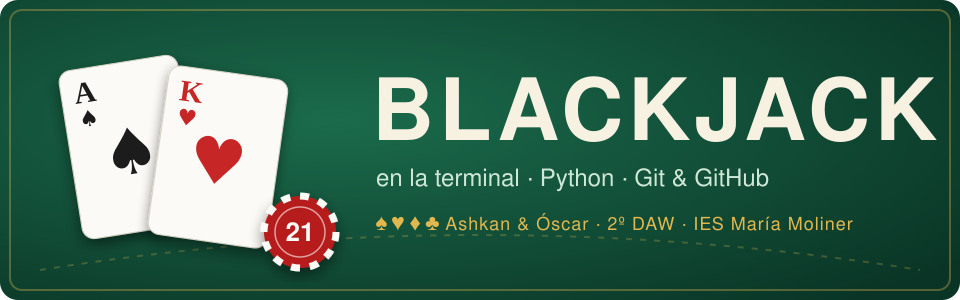
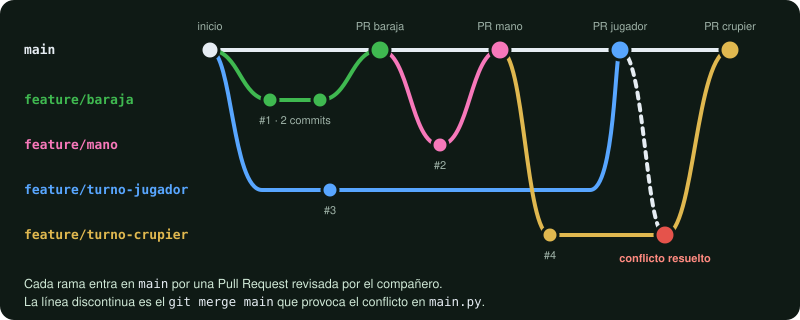

<div align="center">



### Blackjack en la terminal, escrito en Python y hecho a cuatro manos con Git y GitHub


[Cómo jugar](#-cómo-jugar) · [Reglas](#-reglas) · [Cómo está hecho](#-cómo-está-hecho) · [Cómo trabajamos](#-cómo-trabajamos-con-git) · [Equipo](#-equipo)

</div>

---

## 🎮 Cómo jugar

Solo necesitas **Python 3**. No hay nada que instalar, porque el juego usa únicamente la librería estándar.

```bash
git clone https://github.com/EternalShadow00/blackjack-termina-ashkan-oscar.git
cd blackjack-termina-ashkan-oscar
python main.py
```

En tu turno escribes **`p`** para pedir carta o **`s`** para plantarte. Así va una partida real:

```text
=== BLACKJACK ===

Carta visible del crupier: 2♠
Tu mano: J♦ 2♦ (12)
¿Pides carta (p) o te plantas (s)? p
Te sale: 6♣
Tu mano: J♦ 2♦ 6♣ (18)
¿Pides carta (p) o te plantas (s)? s
Te plantas.
Mano del crupier: 2♠ Q♣ (12)
El crupier pide y le sale: A♦
Mano del crupier: 2♠ Q♣ A♦ (13)
El crupier pide y le sale: 9♠
Mano del crupier: 2♠ Q♣ A♦ 9♠ (22)
El crupier se ha pasado de 21. ¡Ganas!

¿Otra partida? (s/n) n
¡Hasta la próxima!
```

> 💡 En esta partida el **A♦** del crupier vale **1**: con 11 se habría pasado de 21.

---

## 🃏 Reglas

| Carta | Valor |
|:---:|:---|
| `2` … `10` | Lo que indica la carta |
| `J` `Q` `K` | **10** |
| `A` | **11**, o **1** si con 11 la mano se pasa de 21 |

1. Se baraja una baraja francesa de **52 cartas** al empezar cada partida.
2. Tú y el crupier recibís **2 cartas**. Del crupier solo ves la primera; la otra está boca abajo.
3. **Tu turno:** pides carta hasta que te plantes. Si pasas de **21**, pierdes al momento.
4. **Turno del crupier:** enseña su carta oculta y pide mientras tenga **menos de 17**.
5. **Resultado:** si el crupier se pasa de 21, ganas. Si no, gana quien tenga más puntos. Con los mismos puntos hay empate.

---

## 🛠️ Cómo está hecho

```
blackjack-termina-ashkan-oscar/
├── 🂡 baraja.py      → crear, barajar y repartir las cartas
├── ✋ mano.py        → contar los puntos y mostrar una mano
├── 🎲 main.py        → el juego: tu turno, el del crupier y quién gana
├── 📄 README.md
└── 📁 docs/
    ├── proceso-git.md   → cómo hemos trabajado con Git, paso a paso
    └── img/             → capturas del proceso
```

Una **carta** es una tupla `(valor, palo)`, por ejemplo `("A", "♠")`, y una **mano** es una lista de cartas.

| Archivo | Funciones |
|---|---|
| `baraja.py` | `crear_baraja()` · `barajar(baraja)` · `repartir(baraja)` |
| `mano.py` | `calcular_puntos(mano)` · `mostrar_mano(mano)` |
| `main.py` | `turno_jugador()` · `turno_crupier()` · `decidir_ganador()` · `jugar_partida()` · `main()` |

---

## 🌿 Cómo trabajamos con Git

Cada tarea es una **Issue**, se programa en su propia rama `feature/...` y entra en `main` mediante una **Pull Request** que revisa el compañero. La rama `main` está **protegida**: nadie puede subir nada directamente, y cada PR necesita **1 aprobación**.

<p align="center"></p>

| # | Issue | Rama |
|:-:|---|---|
| 1 | Baraja: crear, barajar y repartir | `feature/baraja` |
| 2 | Mano: calcular los puntos (el As vale 1 u 11) | `feature/mano` |
| 3 | Turno del jugador: pedir carta o plantarse | `feature/turno-jugador` |
| 4 | Turno del crupier y quién gana | `feature/turno-crupier` |
| 5 | Documentación | `feature/docs-...` |

El proceso completo, con capturas, está en [`docs/proceso-git.md`](docs/proceso-git.md).

---

## 👥 Equipo

| | Quién | Qué hizo |
|:-:|---|---|
| ♠ | **Ashkan Sevinov** · [@EternalShadow00](https://github.com/EternalShadow00) | Administración del repo, `baraja.py`, turno del jugador y este README |
| ♥ | **Óscar** · [@Oscarblan4](https://github.com/Oscarblan4) | `mano.py`, turno del crupier y `docs/proceso-git.md` |

<div align="center">

**IES María Moliner · 2º DAW · Módulo Optativo · 2026-2027**

♠ ♥ ♦ ♣

</div>
